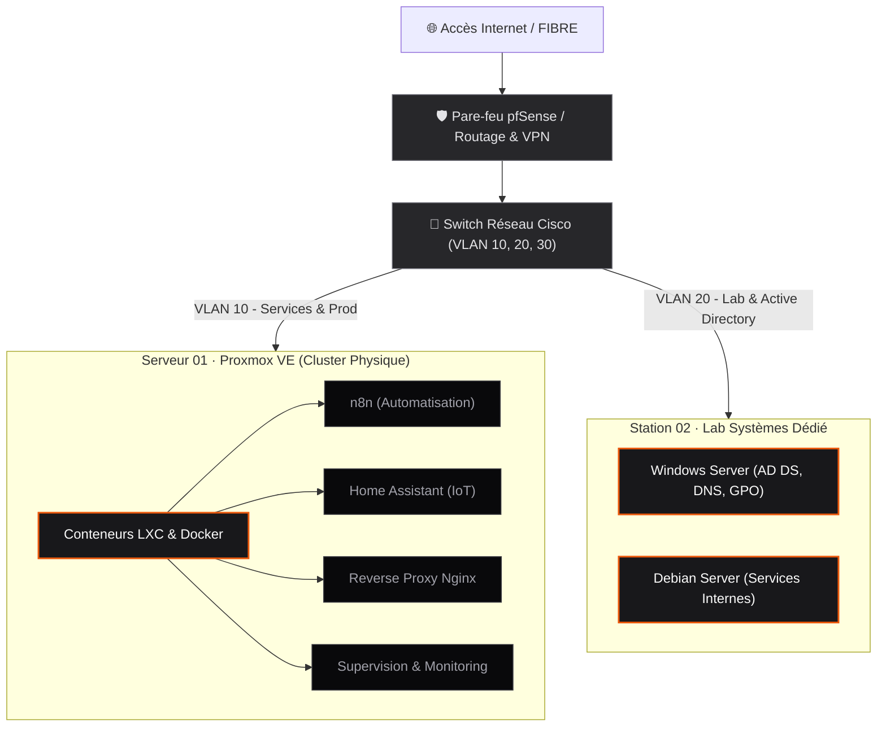
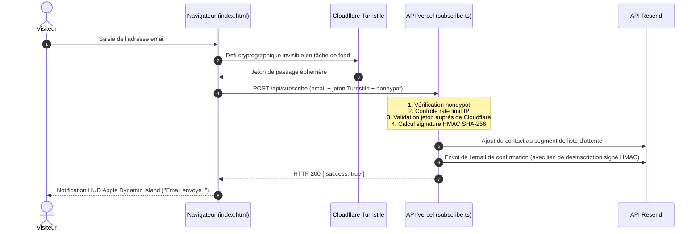

<div align="center">

  

  <h1>yanis-harrat.com</h1>

  <p>
    <strong>Page d'attente officielle & vitrine technique</strong><br>
    <em>Administration Systèmes, Réseaux Cisco, Virtualisation & Cloud</em>
  </p>

  <p>
    <a href="https://www.yanis-harrat.com">🌐 Voir le site en direct</a> •
    <a href="mailto:yanis@yanis-harrat.com">✉️ Me contacter</a> •
    <a href="https://www.linkedin.com/in/yanis-harrat/">💼 LinkedIn</a> •
    <a href="https://github.com/yanix2445">💻 GitHub</a>
  </p>

</div>


> [!TIP]
> **Disponibilité Alternance (2 ans) :**  
> Étudiant en 1ère année de BTS SIO SISR à **Aurlom Paris**, disponible **immédiatement** au rythme **3 jours en entreprise / 2 jours en formation** sur Paris et toute l'Île-de-France.


## Le projet en deux mots

Plutôt que d'envoyer un énième CV PDF standardisé avec une liste de mots-clés abstraits, j'ai codé cette page d'attente pour poser les bases de ce que je construis au quotidien. 

C'est à la fois :
1. **La porte d'entrée de mon futur portfolio** : un espace où je vais documenter mes architectures réelles, mes machines physiques et mes scripts.
2. **Une vraie liste d'attente technique** : les gens laissent leur email, reçoivent un mot de confirmation instantané et seront avertis dès que le portfolio complet sera en ligne.
3. **Une preuve de rigueur** : même pour une simple page d'attente, pas de template WordPress ou de Webflow boursouflé. Juste 32 Ko de HTML pur, une Clean Architecture en TypeScript strict et une sécurité blindée sans captcha visuel.


## Ce qui tourne chez moi (Homelab & Infra physique)

Pour moi, l'administration système ne s'apprend pas uniquement sur des plateformes de simulation. J'ai monté mon propre lab physique pour manipuler du vrai matériel et gérer mes pannes :



### Ce que j'y fais :
* **Virtualisation & Conteneurs :** Deux machines physiques sous **Proxmox VE**, orchestrant des conteneurs LXC et Docker pour mes services perso (n8n pour mes workflows d'automatisation, Home Assistant, reverse proxy Nginx).
* **Réseau :** Segmentation par VLANs sur matériel Cisco, routage OSPF, pare-feu pfSense/Fortinet et passerelle VPN sécurisée.
* **Systèmes & Scripting :** Gestion quotidienne d'environnements Linux (Debian, Ubuntu Server) et Windows Server (Active Directory, GPO, DNS, DHCP), avec du scripting en Bash, PowerShell et Python pour tout automatiser.
* **Certifications validées :** Google Cybersecurity, Google IT Support, Cisco Introduction to Cybersecurity, Anthropic Claude Platform.


## Le flux de la liste d'attente (Sécurité sans friction)

Comment fonctionne l'inscription et la protection anti-abus, de bout en bout :



## Architecture logicielle (Clean Architecture)

Le backend est structuré selon les principes du Clean Code, séparant le domaine métier pur des adaptateurs externes :

<details>
<summary><strong>📂 Explorer l'arborescence du projet (cliquer pour dérouler)</strong></summary>

```text
portfolio-page-attente/
├── api/                            # Contrôleurs Serverless Vercel (minces et isolés)
│   ├── subscribe.ts                # POST /api/subscribe (inscription)
│   └── unsubscribe.ts              # GET /api/unsubscribe (désinscription Web & One-Click)
├── assets/                         # Médias optimisés (WebP prioritaires + fallbacks PNG)
│   ├── mascot.webp / mascot.png    # Mascotte 3D (96 Ko WebP / 705 Ko PNG)
│   ├── logo.webp / logo.png        # Logo personnel (13 Ko WebP / 60 Ko PNG)
│   ├── og-image.png                # Carte Open Graph de partage social (1200×630)
│   └── favicon-*.png               # Favicons multi-tailles & Apple Touch Icon
├── src/
│   ├── core/                       # Couche Domaine (TypeScript pur, 0 dépendance externe)
│   │   ├── types.ts                # Contrats d'interfaces, entrées/sorties strictes
│   │   ├── errors.ts               # Classes d'erreurs HTTP typées (400, 403, 429)
│   │   └── validation.ts           # Validation pure de l'email & détection honeypot
│   ├── infrastructure/             # Adaptateurs d'infrastructure (services tiers)
│   │   ├── config.ts               # Configuration globale et variables d'environnement
│   │   ├── security.provider.ts    # Signatures cryptographiques HMAC et gestion CORS
│   │   ├── turnstile.client.ts     # Client de vérification d'API Cloudflare Turnstile
│   │   └── resend.client.ts        # Client API Resend (gestion d'audience et envoi)
│   ├── services/                   # Couche Application (Orchestration des flux métier)
│   │   ├── rate-limiter.service.ts # Fenêtre glissante par IP et cooldown d'email
│   │   ├── subscription.service.ts # Flux complet d'inscription à la liste d'attente
│   │   └── unsubscribe.service.ts  # Vérification du HMAC et désactivation du contact
│   └── templates/
│       └── confirmation.template.ts # Générateur d'email dynamique avec HMAC scellé
├── index.html                      # Interface utilisateur complète (32 Ko de HTML pur)
├── llms.txt                        # Fichier standard d'ingestion pour les assistants IA
├── robots.txt                      # Directives de crawl (moteurs de recherche & bots IA)
├── sitemap.xml                     # Plan de site XML avec schéma d'images Google
├── tsconfig.json                   # Configuration TypeScript 7 stricte (NodeNext)
└── vercel.json                     # En-têtes de sécurité (CSP, HSTS), rewrites & cache CDN
```

</details>

## Les choix de sécurité en détail

Dès qu'un formulaire public est exposé sur le web, les scripts automatisés attaquent en boucle. Voici les choix techniques retenus :

| Protection | Fonctionnement concret |
| :--- | :--- |
| **Cloudflare Turnstile (Invisible)** | Le navigateur résout un challenge cryptographique invisible sans obliger l'utilisateur à cliquer sur des images de bus ou de feux tricolores. Le jeton est vérifié par le serveur en tâche de fond. |
| **Signatures HMAC SHA-256** | Chaque lien de désinscription envoyé par email contient un token signé `crypto.createHmac('sha256', SECRET)` vérifié via `crypto.timingSafeEqual`. Impossible pour un pirate de désinscrire un tiers en devinant son email dans l'URL. |
| **CORS verrouillé** | Seuls le domaine officiel `https://www.yanis-harrat.com` et les ports locaux de test sont autorisés à appeler l'API. |
| **Honeypot + Rate Limiter** | Un champ masqué hors écran piège les bots naïfs. Une fenêtre glissante en mémoire bloque les soumissions en rafale depuis une même adresse IP. |
| **En-têtes HTTP durcis** | CSP sur-mesure dans [`vercel.json`](vercel.json), HSTS sur 2 ans (`max-age=63072000; preload`), `Referrer-Policy: strict-origin-when-cross-origin` et désactivation des capteurs via `Permissions-Policy`. |

## Les chiffres & la performance

| Élément | Avant | Après optimisation | Gain |
| :--- | :--- | :--- | :--- |
| **Poids du document HTML** | 2,75 Mo *(image en base64 inline)* | **32 Ko** *(code sémantique pur)* | **-98,8 %** |
| **Illustration Mascotte Hero** | 2,05 Mo *(PNG lourd)* | **96 Ko** *(WebP moderne)* | **-95,3 %** |
| **Logo de marque** | 1,17 Mo *(PNG haute résolution)* | **13 Ko** *(WebP 256×256)* | **-98,9 %** |
| **Durée du cache CDN (`/assets/*`)** | Non optimisé | **1 an immuable** (`max-age=31536000`) | Chargement instantané |
| **Ergonomie tactile & motion** | Standard | **Apple HIG (44 px) + ressorts CSS** | Rendu 60 fps natif |

## Lancer le projet en local

### Prérequis
* Node.js (version 20 LTS ou supérieure)
* pnpm (`corepack enable pnpm`)

### Installation & Vérifications

```bash
# 1. Cloner le dépôt
git clone https://github.com/yanix2445/portfolio-page-attente.git
cd portfolio-page-attente

# 2. Installer les dépendances avec pnpm
pnpm install

# 3. Contrôler le typage strict TypeScript
pnpm run type-check
```

### Variables d'environnement

Créer un fichier `.env.local` à la racine pour tester les Serverless Functions :

```env
RESEND_API_KEY=re_xxxxxxxxxxxx
RESEND_SEGMENT_ID=573be7ef-e507-4299-9de5-3ef2dc46917c
TURNSTILE_SECRET_KEY=0x4AAAAAA...
UNSUBSCRIBE_SECRET=votre-cle-secrete-locale
```

## Contact & Alternance

Je suis disponible dès maintenant pour échanger autour d'une **alternance de 2 ans en BTS SIO SISR** sur Paris et l'Île-de-France (rythme : 3 jours en entreprise / 2 jours à l'école Aurlom) :

* **Email :** [yanis@yanis-harrat.com](mailto:yanis@yanis-harrat.com)
* **LinkedIn :** [linkedin.com/in/yanis-harrat](https://www.linkedin.com/in/yanis-harrat/)
* **GitHub :** [github.com/yanix2445](https://github.com/yanix2445)
* **Site officiel :** [https://www.yanis-harrat.com](https://www.yanis-harrat.com)

<div align="center">
  <small>© 2026 Yanis Harrat · Conçu avec rigueur et passion pour l'infrastructure</small>
</div>
