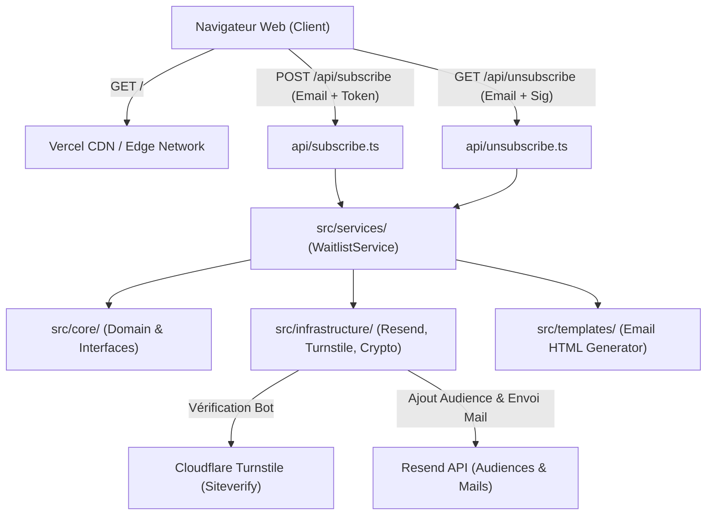

# INSTALL.md — portfolio-page-attente (yanis-harrat.com)

Spécification d'architecture, vision technique et guide d'installation du projet.

## Vision

Page d'attente et de capture de contacts pour le lancement du portfolio d'ingénierie système & réseau de Yanis Harrat.

Cette application web statique avec fonctions serverless sert de point d'ancrage officiel pour le domaine `yanis-harrat.com`. Elle permet aux recruteurs, professionnels et pairs de s'inscrire pour être notifiés de l'ouverture du portfolio complet, tout en garantissant une expérience utilisateur ultra-rapide (<100ms), une conformité légale totale (LCEN/RGPD) et une protection anti-abus multicouche sans friction.

## Decisions

| Décision | Choix | Justification |
| :--- | :--- | :--- |
| **Architecture** | Clean Architecture modulaire (Core / Infrastructure / Services / Templates / API) | Découplage strict entre la logique métier pure, les intégrations externes (Resend, Turnstile) et les contrôleurs serverless Vercel. |
| **Front-end** | HTML5 sémantique & CSS3 vanilla natif (sans framework JS lourd) | Poids plume, zéro dépendance cliente, chargement instantané, compatibilité navigateurs maximale et accessibilité native. |
| **Back-end** | Vercel Serverless Functions (`@vercel/node`) | Exécution à la demande sans serveur à administrer, coût nul, montée en charge automatique et temps de réponse minimal. |
| **Langage & Typage** | TypeScript 7.0 (`NodeNext` strict) & PNPM 12 | Sécurité de typage totale, import ESM natif, cohérence d'environnement et gestionnaire de paquets ultra-rapide. |
| **Emailing** | Resend API & SDK TypeScript officiel | Gestion des audiences, conformité RFC 8058 (désinscription en 1 clic), délivrabilité optimale et templates personnalisés scellés. |
| **Sécurité Anti-Abus** | Cloudflare Turnstile invisible + HMAC SHA-256 | Vérification anti-bot passive et transparente pour l'utilisateur, signatures cryptographiques scellées pour la désinscription sécurisée. |
| **Hébergement** | Vercel Edge / Serverless Platform | Déploiement continu via Git, gestion intégrée des en-têtes de sécurité (CSP strict, HSTS A+, Permissions-Policy) et CDN mondial. |

## Stack summary

- **Front-end :** HTML5, CSS3 vanilla (design tokens CSS, Dark Theme), WebP optimisé
- **Back-end :** Node.js 22, Vercel Serverless Functions (`api/subscribe.ts`, `api/unsubscribe.ts`)
- **Typage & Build :** TypeScript 7.0.2, `@types/node` 26.6.5, `@vercel/node` 27.0.2
- **Gestionnaire de dépendances :** PNPM 12
- **Services tiers :** Resend API (Audiences & Transactionnel), Cloudflare Turnstile (Siteverify)
- **Hébergement :** Vercel (Région iad1 / Global CDN)

## Architecture



Les contrôleurs dans `api/` agissent comme des façades minces qui délèguent le traitement au `WaitlistService`. La couche `infrastructure` encapsule les appels HTTP tiers (Resend, Cloudflare) et les fonctions cryptographiques Node.js (`crypto.createHmac`, `timingSafeEqual`), sans fuite d'implémentation vers le domaine métier.

## Folder structure

```
portfolio-page-attente/
├── .agents/                    # Contexte marketing et persona produit
├── aidd_docs/                  # Documentation vivante & Banques de mémoire AIDD
│   ├── memory/                 # Banques de mémoire actives lues par les agents IA
│   ├── CONTRIBUTING.md         # Guide de contribution au contexte IA
│   ├── GUIDELINES.md           # Règles opérationnelles de l'équipe
│   ├── INSTALL.md              # Ce document d'architecture et d'installation
│   └── README.md               # Index de la documentation
├── api/                        # Contrôleurs Vercel Serverless Functions
│   ├── subscribe.ts            # POST /api/subscribe (inscription liste d'attente)
│   └── unsubscribe.ts          # GET /api/unsubscribe (désinscription sécurisée HMAC)
├── assets/                     # Ressources statiques optimisées
│   ├── logo.webp               # Logo optimisé WebP (13 Ko)
│   ├── mascot.webp             # Mascotte optimisée WebP (96 Ko)
│   └── fonts/                  # Polices web locales
├── src/                        # Logique métier découplée (Clean Architecture)
│   ├── core/                   # Entités et interfaces métier
│   ├── infrastructure/         # Adaptateurs Resend, Cloudflare et Sécurité
│   ├── services/               # Services applicatifs orchestrateurs
│   └── templates/              # Générateur de templates emails transactionnels
├── index.html                  # Page d'attente principale avec formulaire
├── mentions-legales.html       # Mentions légales et politique RGPD
├── package.json                # Dépendances et scripts de vérification
├── pnpm-lock.yaml              # Verrouillage exact des versions PNPM
├── robots.txt                  # Directives d'indexation SEO et agents IA
├── sitemap.xml                 # Plan du site avec balises d'images
├── llms.txt                    # Standard d'ingestion pour les LLM
├── tsconfig.json               # Configuration TypeScript 7 (NodeNext)
└── vercel.json                 # Règles de routage, en-têtes CSP/HSTS et cache
```

## Install steps

1. **Cloner le dépôt et entrer dans le répertoire :**
   ```bash
   git clone git@github.com:yanisharrat/portfolio-page-attente.git
   cd portfolio-page-attente
   ```

2. **Installer les dépendances avec PNPM :**
   ```bash
   pnpm install --frozen-lockfile
   ```

3. **Configurer les variables d'environnement locales :**
   Créer un fichier `.env.local` à la racine :
   ```env
   RESEND_API_KEY=re_xxxxxxxxxxxxxxxxxxxxxxxxx
   RESEND_AUDIENCE_ID=573be7ef-e507-4299-9de5-3ef2dc46917c
   TURNSTILE_SECRET_KEY=0x4AAAAAA...
   UNSUBSCRIBE_HMAC_SECRET=cle_secrete_hmac_aleatoire_64_caracteres
   ```

4. **Valider le typage TypeScript :**
   ```bash
   pnpm run type-check
   ```

5. **Lancer l'environnement de développement local avec Portly :**
   ```bash
   portly start portfolio-page-attente
   ```

## Audit summary

Multi-agent audit validé lors de la phase de cadrage :

| Candidat | Statut | Synthèse |
| :--- | :--- | :--- |
| **Next.js Fullstack (App Router)** | ⚠️ Écarté | Poids excessif pour une page d'attente unique, hydration JavaScript superflue. |
| **HTML Vanilla + Fonctions Serverless Vercel (Retenu)** | ✅ Validé | Score Core Web Vitals 100/100, cold-start minimal, surface d'attaque réduite et simplicité opérationnelle. |
| **Cloudflare Pages + Workers** | ⚠️ Optionnel | Excellente performance mais migration prématurée alors que l'écosystème Vercel est déjà configuré. |
