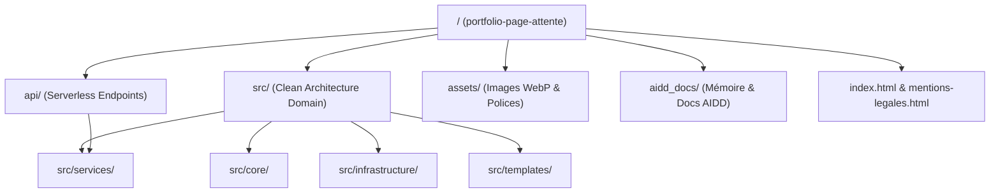

# Codebase Map

Organisation modulaire et cartographie du code source de **portfolio-page-attente**.

## Areas

- [`api/`](../../api/) : Contrôleurs d'API Serverless Vercel (`subscribe.ts`, `unsubscribe.ts`). Façades légères de validation HTTP et de routage.
- [`src/core/`](../../src/core/) : Définitions de types purs, interfaces de passerelles et règles du domaine.
- [`src/infrastructure/`](../../src/infrastructure/) : Adaptateurs externes (Client Resend, validation Turnstile, signature cryptographique HMAC).
- [`src/services/`](../../src/services/) : Orchestration des cas d'usage applicatifs (`WaitlistService`).
- [`src/templates/`](../../src/templates/) : Génération programmatique des templates d'emails transactionnels scellés.
- [`assets/`](../../assets/) : Ressources multimédias statiques optimisées (`logo.webp`, `mascot.webp`, polices web).
- [`aidd_docs/`](../../aidd_docs/) : Banques de mémoire de l'assistant IA, spécifications d'architecture et journal de bord.

## Entry points

- **Web Statique :** [`index.html`](../../index.html) (Point d'entrée navigateur pour la page d'accueil) et [`mentions-legales.html`](../../mentions-legales.html).
- **API Serverless :** [`api/subscribe.ts`](../../api/subscribe.ts) (Point d'entrée serveur pour l'inscription) et [`api/unsubscribe.ts`](../../api/unsubscribe.ts) (Point d'entrée pour la désinscription).
