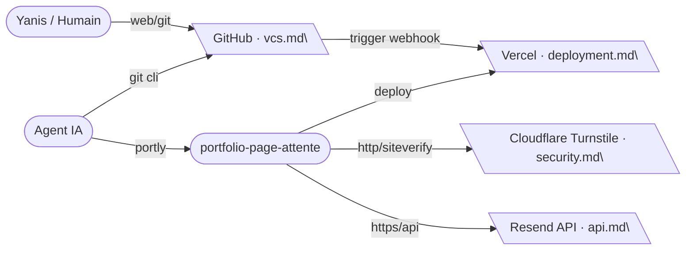

# Ecosystem

Cartographie des outils externes, plateformes cloud et flux d'intégration.

## External Tools & Services

- **GitHub :** Hébergement du code source et déclencheur des déploiements Vercel via intégration webhook native.
- **Vercel :** Hébergement de la page web, CDN mondial et exécution des fonctions serverless Node.js.
- **Resend :** Service d'envoi d'emails transactionnels et gestion de l'audience d'abonnés (`yanis-harrat.com`).
- **Cloudflare :** Protection bot Turnstile invisible via widget frontend et validation serveur Siteverify.
- **Portly :** Superviseur macOS de processus locaux pour le contrôle et l'isolation des serveurs de développement.
